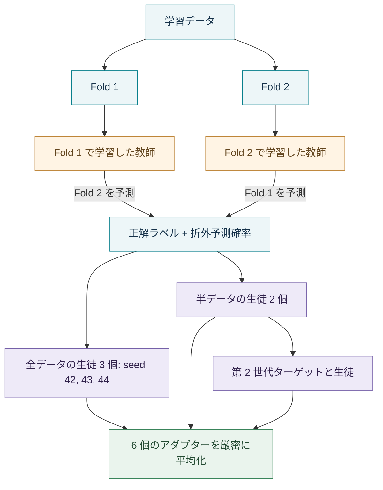

<div align="center">

# OOF-SD-LoRA-Soup

**Out-of-fold 自己蒸留と LoRA 更新の厳密な平均化による、多言語の感情分類。**

[English](README.md) · **日本語**


[](LICENSE)

4 つのデータセットに共通の学習手順を適用。予測は 1 回の順伝播で完結。

[実験結果](#実験結果) · [クイックスタート](#クイックスタート) · [手法](#手法) · [実験の再現](#実験の再現) · [ライセンス](#ライセンス)

</div>

> **ソースコード配布版。** コード、設定、fold の割り当て、集計結果を含みます。モデル重み、データ本文、ソフトターゲット、学習ログ、個別予測は含みません。まず `python tools/app.py --no-models` で結果ページを確認できます。推論・学習に必要なファイルは [アセットの準備](docs/ASSETS.md#日本語) を参照してください。

## 概要

本プロジェクトは、卒業研究 **Out-of-Fold Self-Distillation and LoRA Soups for Multilingual Social Media Emotion Classification with a Compact Large Language Model** のコードと実験資料をまとめたものです。

Qwen3.5-4B の重みを固定し、中国語・英語・日本語の感情分類用 LoRA アダプターを学習します。学習対象のサンプルを直接見ていない教師モデルがソフトターゲットを作成し、最後に 6 個の生徒アダプターの重み更新を厳密に平均化します。推論では、感情を表す単一トークンの候補から予測するため、長い推論文の生成や回答文の解析は必要ありません。

アダプターはデータセットごとに学習しています。4 つのデータセットを混ぜて 1 つの多言語分類器を作るのではなく、同じ学習手順が異なるデータセットでも機能するかを検証しています。


## 実験結果

値はテストセットの百分率です。比較対象は seed 42 の通常の LoRA 微調整です。**Δ MF1** は Macro-F1 の差をパーセントポイントで表します。Macro-F1 には neutral を含む全クラスを用います。

| データセット | 言語 | クラス数 | LoRA-FT MF1 | SD-Soup MF1 | Δ MF1 | SD-Soup 正解率 |
|:--|:--:|--:|--:|--:|--:|--:|
| SMP2020-EWECT usual | 中国語 | 6 | 76.97 | **79.68** | +2.71 | 82.06 |
| SMP2020-EWECT virus | 中国語 | 6 | 66.60 | **70.05** | +3.45 | 82.70 |
| GoEmotions、Ekman 分類 | 英語 | 7 | 64.34 | **66.72** | +2.38 | 72.69 |
| WRIME ver2、9 クラス設定 | 日本語 | 9 | 49.79 | **52.47** | +2.68 | 66.38 |

**結果の解釈。** 最終モデルとの比較は、virus と GoEmotions で Holm 補正後も有意でした。WRIME の Macro-F1 の差は有意ではありません（`p = 0.159`）。usual ではテスト結果を確認した後に均等重みの 6 メンバースープを選択しているため、この比較は事後分析に当たります。他の 3 データセットでは、結果が得られる前に学習手順を固定しました。

同じ seed 同士の 12 組すべてで OOF-SD の Macro-F1 が高くなりましたが、seed 平均の差が所定の検定を通過したのは usual と virus です。通常の LoRA アダプターを平均化しても改善するため、最終的な向上を自己蒸留だけの効果とは見なせません。

SMP2020-EWECT の総合スコアは、usual と virus の Macro-F1 の平均である **74.87** です。既報のシステムとは使用資源や評価条件が異なります。公開スコアは参考値であり、最高性能を更新したことの証明には用いていません。

詳細：[スコア](reference/results.json) · [対応のある検定](reference/statistics.json) · [アブレーション](reference/ablations.json) · [個別予測の準備](docs/ASSETS.md#日本語) · [既報との比較](reference/published_results.json)。

## クイックスタート

コマンドはプロジェクトのルートディレクトリで実行します。推論のために再学習する必要はありません。

### 1. 環境を用意する

```bash
conda create -n fyp python=3.11 -y
conda activate fyp
python -m pip install -r requirements.txt
```

既に `fyp` がある場合は、作成を省略して有効化してください。[requirements.txt](requirements.txt) は実験で使用したバージョンを固定しています。NVIDIA 環境では、使用環境に適した CUDA 版 PyTorch をインストールしてください。Apple silicon では、macOS と PyTorch が対応していれば、通常の macOS 版で MPS を利用できます。

### 2. ローカルのモデルファイルを確認する

モデルは `local_files_only=True` で読み込まれます。ソースコードだけを取得しても推論はできません。完全な実験パッケージでは、次の場所に基盤モデルとアダプターがあります。

```text
models/Qwen3.5-4B/                    # 基盤モデル、トークナイザー、設定
weights/usual/sd_uniform6_soup/       # 中国語：一般的な Weibo 投稿
weights/virus/sd_uniform6_soup/       # 中国語：COVID-19 関連の Weibo 投稿
weights/goemotions/sd_uniform6_soup/  # 英語：Reddit
weights/wrime/sd_uniform6_soup/       # 日本語：ソーシャルメディア
```

各アダプターには `adapter_config.json` と `adapter_model.safetensors` が必要です。基盤モデルのリビジョンは [model_manifest.json](model_manifest.json) に記録されています。`--model-dir /path/to/Qwen3.5-4B` で基盤モデルの場所を変更できますが、アダプターをダウンロードする機能ではありません。

### 3. ローカルデモを起動する

```bash
python tools/app.py --device auto
```

**http://127.0.0.1:7860** を開き、データセットとモデルを選択してテキストを入力します。各クラスの確率が表示されます。モデルは最初の推論リクエストで読み込まれます。

| 実行環境 | コマンド |
|:--|:--|
| Apple silicon GPU | `python tools/app.py --device mps` |
| NVIDIA GPU | `python tools/app.py --device cuda` |
| CPU | `python tools/app.py --device cpu --threads 4` |
| モデルを読み込まず結果ページだけ表示 | `python tools/app.py --no-models` |

`auto` は CUDA、MPS、CPU の順に選択します。ポート 7860 が使用中なら `--port 7861` を指定し、そのポートの URL を開いてください。終了は **Ctrl+C** です。

BF16 推論では約 10 GB のメモリを目安にしてください。FP32 では大幅に増えます。MPS で BF16 の動作確認に失敗すると FP32 に切り替わります。また、読み込み済みアダプターを切り替えるとメモリ使用量が増える場合があります。研究で報告したスコアは NVIDIA 環境で取得しており、他のデバイスでは小さな数値差が生じることがあります。

## 予測と評価

```bash
python tools/predict.py --domain usual "排了三个小时的队，结果系统坏了，气死我了。"
python tools/predict.py --domain virus "小区又封了，什么时候才是个头啊。"
python tools/predict.py --domain goemotions "I can't believe they cancelled the show again."
python tools/predict.py --domain wrime "明日から待ちに待った旅行だ。"
```

1 行に 1 件のテキストを記載した UTF-8 ファイルも使えます。

```bash
python tools/predict.py --domain wrime --file texts.txt --device mps
```

既定のモデルは `--model soup` です。ほかに `a_soup`、`A_s42`、`A_s43`、`A_s44`、`SD_s42`、`SD_s43`、`SD_s44`、`SDfold1`、`SDfold2`、`SDgen2`、`Afold1`、`Afold2`、またはアダプターのディレクトリを指定できます。

WRIME のデータセット評価には、ローカルで split を再構築する必要があります。任意の日本語テキストを入力するだけなら、この処理は不要です。

```bash
python tools/build_wrime.py
python tools/evaluate.py --domain usual --split test --model soup
python tools/evaluate.py --domain both --split test --model soup
python tools/evaluate.py --domain goemotions --split test --model A_s42
python tools/evaluate.py --domain wrime --split dev --model soup --limit 64
```

正解率、Macro-F1、クラス別指標、混同行列を出力します。参照予測がある場合は、ラベル一致率と確率差も確認します。`--save DIR` で予測を保存できます。`--domain both` は中国語の 2 ドメインを評価し、Macro-F1 の平均も出力します。

Thesis I の RoBERTa ベースラインは別のスクリプトで評価できます。

```bash
python thesis1/evaluate.py --model roberta_bigru --split test
```

## 手法

### Out-of-fold 自己蒸留

学習データをクラス比率に基づいて 2 分割します。一方の fold で学習した教師が、もう一方を予測します。生徒は正解ラベルと教師のクラス確率を混合したターゲットで学習します。

```text
生徒のターゲット = 0.7 × 正解の one-hot ラベル + 0.3 × 折外教師の確率
```

同一テキストが両方の fold に存在する場合は、ハードな正解ラベルを維持します。基盤モデルは固定し、LoRA パラメーターだけを更新します。学習損失は回答位置の全語彙に対する交差エントロピーです。推論時は、そのデータセットの回答語だけで確率を正規化します。



第 2 世代の教師は、自身の学習用ソフトターゲットを通じて、反対側の fold の正解ラベルに間接的に接しています。その教師正解率を、完全に独立した折外評価とは解釈できません。

### LoRA 更新の厳密な平均化

アダプターの更新を `ΔW = (α/r) BA` とすると、求めたいのは **更新行列の平均** です。`A` と `B` をそれぞれ平均してから掛けても、同じ結果にはなりません。

```text
A_soup = vertical_stack(A_1, ..., A_6)
B_soup = horizontal_stack(B_1, ..., B_6) / 6
r_soup = 48,  α_soup = 96
ΔW_soup = (ΔW_1 + ... + ΔW_6) / 6
```

出力は rank 48 のアダプター 1 個です。付属の scorer はこれを PEFT アダプターとして読み込み、1 回の順伝播で推論します。基盤モデルへの重み統合は自動では行いません。更新を基盤モデルに統合すると元のモデルと同じ推論構造になりますが、未統合の rank 48 の LoRA 分岐は rank 8 のメンバーより幅が広くなります。

| 学習設定 | 値 |
|:--|:--|
| 基盤モデル | Qwen3.5-4B、重み固定、thinking 無効 |
| 各メンバーの LoRA | Rank 8、alpha 16、dropout 0.05 |
| 適用対象 | 248 個の線形射影、学習可能パラメーター 16,232,448 個 |
| 最適化 | AdamW、学習率 `2e-4`、実効バッチサイズ 16 |
| 学習と選択 | 最大 3 epoch、検証 Macro-F1 で選択、patience 1 |
| 入力長 | テキストの先頭 128 token |
| 教師の混合比 | 0.3、層化した 2 fold |
| 回答語 | 全データセットで中国語の単一トークン感情語 |

## 実験の再現

まず [アセットの準備](docs/ASSETS.md#日本語) に従って必要なファイルを配置してください。fold は元データの行順に依存するため、別のデータにそのまま流用できません。

まず計画を確認してください。学習実装には CUDA が必要です。本パッケージの MPS 対応は推論向けです。

```bash
python tools/train_pipeline.py --domain usual plan
python tools/train_pipeline.py --domain usual run
python tools/train_pipeline.py --domain usual check-targets
```

出力先は `runs/` で、完了済みの処理は再開時にスキップします。設定は [configs/](configs/) にあります。RTX 4080 で記録した各データセットの 11 回分の学習時間は、usual、virus、GoEmotions、WRIME の順に約 20、5.5、30、22 GPU 時間でした。usual の最終 SD-Soup を構成する 8 回分は 14.09 GPU 時間、通常の LoRA-FT seed 42 は 2.79 GPU 時間です。GPU での再学習はビット単位の完全再現にはなりません。

```bash
# モデルやデータを読み込まず、ソース配布版を検査
python tools/check_source.py

# 元の実験アセットを復元した場合のみ実行
python tools/check_package.py
python tools/build_soup.py --check-all
```

`check_source.py` はソースのハッシュ、Python/JSON の構文、README のファイルリンクを確認します。モデルのスコアは再計算しません。完全な `check_package.py` 検査には元の実験アセットが必要で、基盤モデルを読み込まずに、一覧にあるファイルのハッシュ、split、fold、ターゲット、設定、再構築した soup、保存済み予測の指標を確認します。大きなモデルファイルを読み取るため、時間がかかる場合があります。`--skip-hashes` はハッシュ確認だけを省略します。soup の検査では、一時領域にアダプターを再構築して付属の重みと比較します。

## ディレクトリ構成

この配布版の `models/` と `data/` はライセンス表示のみです。以下の `weights/`、`targets/`、`logs/`、`reference/predictions/` は別途配置するローカルアセットであり、アップロード対象には含めていません。

```text
configs/                 学習設定
models/                  ローカルの Qwen・RoBERTa と上流ライセンス
weights/                 データセット別アダプター、教師、旧ベースライン
data/                    データ、元の配布ファイル、利用条件
folds/                   層化した 2 fold の割り当て
targets/                 蒸留とアブレーション用ターゲット
logs/                    学習履歴と実行記録
reference/               スコア、検定、アブレーション、テキストごとの予測
thesis1/                 旧 RoBERTa モデルと学習・評価コード
tools/                   デモ、予測、評価、前処理、検査
reasoning_training.py    LoRA 学習実装
generation_guard.py      学習コードの依存モジュール
MANIFEST.sha256          ファイル整合性の検証用一覧
```

## データと制約

| データセットキー | Train / dev / test | タスク |
|:--|:--|:--|
| `usual` | 27,766 / 2,000 / 5,000 | 一般的な Weibo 投稿の 6 クラス分類 |
| `virus` | 8,606 / 2,000 / 3,000 | COVID-19 関連の Weibo 投稿の 6 クラス分類 |
| `goemotions` | 39,555 / 4,946 / 4,968 | Ekman 7 クラスへの変換後、1 クラスに定まる投稿を保持 |
| `wrime` | 28,360 / 2,408 / 2,347 | 読者の強度評定の厳密な平均から 9 クラスを作成し、最大値の同点を除外 |

公式の split 境界を維持しています。学習とテストの間には完全に同じテキストの重複があり、学習に存在しないテキストだけの評価も記録しています。基盤モデルが事前学習でこれらの公開データに接した可能性は測定していません。

WRIME のテストセットには angry が 14 件、trust が 6 件しかありません。最終 soup は trust を予測せず、3 個のメンバーが soup より高い Macro-F1 を示しました。メンバー数や蒸留世代を増やしても、必ず改善するとは限りません。各手法の seed 数が 3 個であることも、学習のばらつきに関する結論を制限します。seed 平均の bootstrap は、これらの seed を固定して計算しています。

## ライセンス

本プロジェクト独自のコードと今回の README 文書は [MIT License](LICENSE) で公開します。Copyright © 2026 Deng Yi。この許諾によって、第三者のコード、データセット、事前学習済みモデル、学習済み重み、論文本体が再ライセンスされることはありません。既存の表示と個別の条件は引き続き適用されます。

| 対象 | 利用条件・表示 |
|:--|:--|
| Qwen3.5-4B | [Apache-2.0](models/Qwen3.5-4B/LICENSE) |
| Chinese RoBERTa-wwm-ext | [上流ライセンス](models/chinese-roberta-wwm-ext/LICENSE)と[補足](models/chinese-roberta-wwm-ext/LICENSE_NOTICE.txt) |
| GoEmotions 元データ | [Apache-2.0](data/goemotions/source/LICENSE) |
| WRIME 元データ | [CC BY-NC-ND 4.0](data/wrime/source/LICENSE)、[ローカル処理の説明](data/wrime/NOTICE.txt) |
| SMP2020-EWECT | [主催者](https://smp2020ewect.github.io/)と配布元の条件を参照。本文に MIT の許諾は付与しません |
| 学習済み重み | このコードライセンスの対象外。適用されるモデルとデータの表示を保持してください |

加工済み WRIME split は `tools/build_wrime.py` でローカルに再構築してください。派生したテキスト split を再配布パッケージに含めないでください。コードの MIT License が WRIME の非営利・改変物配布禁止条件を解除することはありません。

## 引用

```bibtex
@thesis{deng2026oofsd,
  author      = {Deng, Yi},
  title       = {Out-of-Fold Self-Distillation and LoRA Soups for Multilingual
                 Social Media Emotion Classification with a Compact Large Language Model},
  institution = {Xiamen University Malaysia},
  type        = {Final Year Project Report},
  year        = {2026}
}
```

データセットの帰属情報と既報の出典は、各データセットの notice と [reference/published_results.json](reference/published_results.json) に記録しています。
