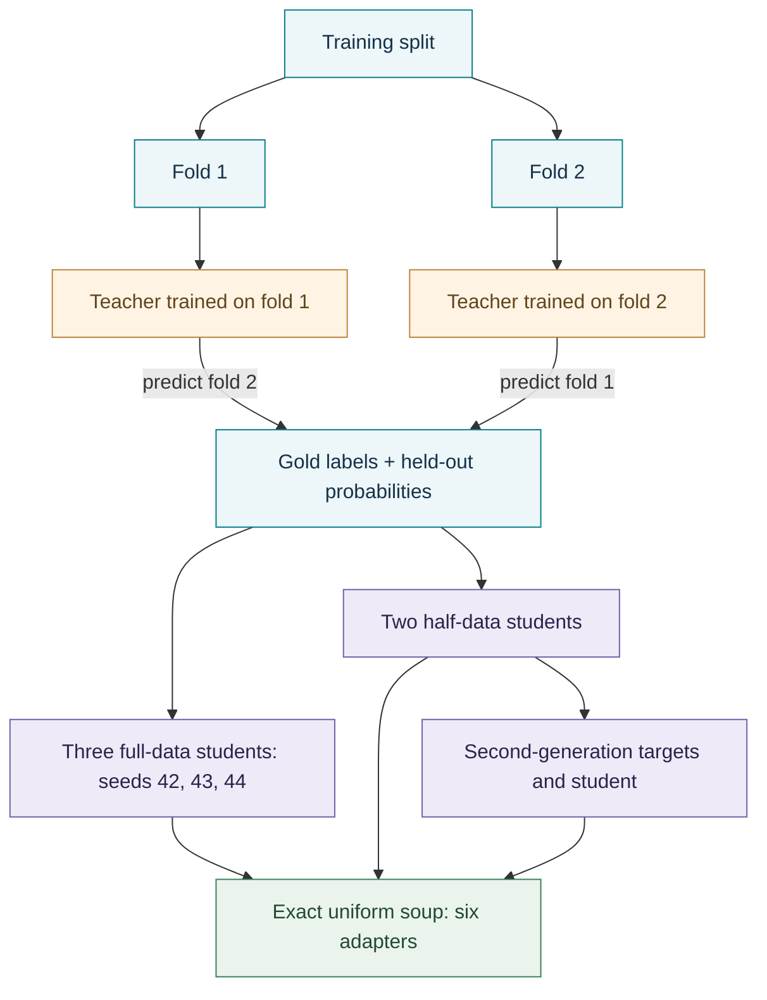

<div align="center">

# OOF-SD-LoRA-Soup

**Multilingual emotion classification with out-of-fold self-distillation and exact LoRA averaging.**

**English** · [日本語](README.ja.md)


[](LICENSE)

Four datasets. A shared training recipe. One model forward pass per prediction.

[Results](#results) · [Quick start](#quick-start) · [Method](#method) · [Reproduction](#reproduction) · [License](#license)

</div>

## Overview

This is the research code and experiment package for **Out-of-Fold Self-Distillation and LoRA Soups for Multilingual Social Media Emotion Classification with a Compact Large Language Model**.

The project keeps Qwen3.5-4B frozen and trains LoRA adapters for Chinese, English and Japanese emotion classification. Out-of-fold teachers supply soft targets for training; six student adapters are then combined by averaging their weight updates exactly. At inference, a restricted set of single-token emotion words turns the language model into a classifier. No generated reasoning trace or answer parsing is needed.

Each dataset has its own trained adapters. This is a replication of the training recipe across datasets, not one multilingual classifier trained jointly on all four.


## Results

Test scores are percentages. The baseline is direct LoRA fine-tuning with seed 42; **Δ MF1** is the change in macro-F1, in percentage points. Macro-F1 includes every class, including neutral.

| Dataset | Language | Classes | LoRA-FT MF1 | SD-Soup MF1 | Δ MF1 | SD-Soup accuracy |
|:--|:--:|--:|--:|--:|--:|--:|
| SMP2020-EWECT usual | Chinese | 6 | 76.97 | **79.68** | +2.71 | 82.06 |
| SMP2020-EWECT virus | Chinese | 6 | 66.60 | **70.05** | +3.45 | 82.70 |
| GoEmotions, Ekman mapping | English | 7 | 64.34 | **66.72** | +2.38 | 72.69 |
| WRIME ver2, nine-class protocol | Japanese | 9 | 49.79 | **52.47** | +2.68 | 66.38 |

**What the evidence supports.** The final-model comparison passes Holm correction on virus and GoEmotions. The WRIME macro-F1 difference is not significant (`p = 0.159`). The uniform six-member soup was selected after its usual test scores were seen, so the usual comparison is post hoc. The other three datasets used a recipe fixed before their results were available.

OOF-SD improves macro-F1 in all 12 same-seed pairs, but its seed-mean advantage survives the specified tests only on usual and virus. Averaging also helps the ordinary LoRA baseline; the full gain should not be attributed to self-distillation alone.

The SMP2020-EWECT aggregate is **74.87**, the mean of usual and virus macro-F1. Published systems used different resources and protocols; their scores are reference points, not evidence of a verified state of the art.

Explore the records: [scores](reference/results.json) · [paired tests](reference/statistics.json) · [ablations](reference/ablations.json) · [per-text predictions](reference/predictions/) · [published references](reference/published_results.json).

## Quick start

Run commands from the project root. Inference does not require retraining.

### 1. Install the environment

```bash
conda create -n fyp python=3.11 -y
conda activate fyp
python -m pip install -r requirements.txt
```

If `fyp` already exists, activate it and skip creation. [requirements.txt](requirements.txt) pins the experiment versions. For NVIDIA systems, install the appropriate CUDA build of PyTorch for your platform. On Apple silicon, the standard macOS build supports MPS when the system and PyTorch report it as available.

### 2. Check the local model files

The tools load models from disk with `local_files_only=True`. A source-only checkout is not enough to run predictions. The complete experiment package contains the backbone and adapters at these paths:

```text
models/Qwen3.5-4B/                    # Backbone, tokenizer and configuration
weights/usual/sd_uniform6_soup/       # Chinese: general Weibo
weights/virus/sd_uniform6_soup/       # Chinese: COVID-19 Weibo
weights/goemotions/sd_uniform6_soup/  # English: Reddit
weights/wrime/sd_uniform6_soup/       # Japanese: social media
```

Each adapter directory needs `adapter_config.json` and `adapter_model.safetensors`. The backbone revision is recorded in [model_manifest.json](model_manifest.json). `--model-dir /path/to/Qwen3.5-4B` overrides its default location; it does not download the adapters.

### 3. Open the local demo

```bash
python tools/app.py --device auto
```

Open **http://127.0.0.1:7860**. Choose a dataset and model, enter a text, and inspect the class probabilities. The model loads on the first inference request.

| Device | Command |
|:--|:--|
| Apple silicon GPU | `python tools/app.py --device mps` |
| NVIDIA GPU | `python tools/app.py --device cuda` |
| CPU | `python tools/app.py --device cpu --threads 4` |
| Results page without loading models | `python tools/app.py --no-models` |

`auto` selects CUDA, then MPS, then CPU. If port 7860 is occupied, use `--port 7861` and open the matching address. Stop the server with **Ctrl+C**.

Plan for roughly 10 GB of memory for BF16 inference; FP32 needs substantially more. MPS falls back to FP32 if its BF16 probe fails, and switching between cached adapters can increase memory use. All reported research scores were obtained on NVIDIA hardware; other devices can produce small numerical differences.

## Prediction and evaluation

```bash
python tools/predict.py --domain usual "排了三个小时的队，结果系统坏了，气死我了。"
python tools/predict.py --domain virus "小区又封了，什么时候才是个头啊。"
python tools/predict.py --domain goemotions "I can't believe they cancelled the show again."
python tools/predict.py --domain wrime "明日から待ちに待った旅行だ。"
```

For a UTF-8 file with one text per line:

```bash
python tools/predict.py --domain usual --file texts.txt --device mps
```

`--model soup` is the default. Other choices include `a_soup`, `A_s42`, `A_s43`, `A_s44`, `SD_s42`, `SD_s43`, `SD_s44`, `SDfold1`, `SDfold2`, `SDgen2`, `Afold1`, `Afold2`, or an adapter directory.

WRIME dataset evaluation requires locally reconstructed splits. Ad hoc Japanese text prediction does not.

```bash
python tools/build_wrime.py
python tools/evaluate.py --domain usual --split test --model soup
python tools/evaluate.py --domain both --split test --model soup
python tools/evaluate.py --domain goemotions --split test --model A_s42
python tools/evaluate.py --domain wrime --split dev --model soup --limit 64
```

Evaluation reports accuracy, macro-F1, per-class metrics and a confusion matrix. Where reference predictions exist, it also checks label agreement and probability differences. Use `--save DIR` to save predictions. `--domain both` evaluates the two Chinese domains and their mean macro-F1.

The earlier RoBERTa baselines are available separately:

```bash
python thesis1/evaluate.py --model roberta_bigru --split test
```

## Method

### Out-of-fold self-distillation

The training set is split into two stratified folds. A teacher trained on one fold predicts the other. Students learn from a mixture of the gold label and the teacher's class probabilities:

```text
student target = 0.7 × one-hot gold label + 0.3 × out-of-fold teacher probabilities
```

Exact texts appearing in both folds retain hard gold targets. The backbone stays frozen; only the LoRA parameters are trained. Training supervises the answer position with full-vocabulary cross-entropy, while inference normalizes over the dataset's answer words.



The second-generation teachers have indirect access to the other fold's gold labels through their own soft targets. Their teacher accuracy should not be read as a fully independent out-of-fold estimate.

### Exact LoRA averaging

For an adapter update `ΔW = (α/r) BA`, the desired soup is the mean of the **updates**, not the product of the means of `A` and `B`.

```text
A_soup = vertical_stack(A_1, ..., A_6)
B_soup = horizontal_stack(B_1, ..., B_6) / 6
r_soup = 48,  α_soup = 96
ΔW_soup = (ΔW_1 + ... + ΔW_6) / 6
```

The result is one rank-48 adapter. The supplied scorer loads it as a PEFT adapter and performs one forward pass. It does not merge it into the backbone automatically. Folding the update into the base weights gives the base model's inference structure; an unmerged rank-48 LoRA branch is wider than a rank-8 member.

| Training setting | Value |
|:--|:--|
| Backbone | Qwen3.5-4B, frozen; thinking disabled |
| Per-member LoRA | Rank 8, alpha 16, dropout 0.05 |
| Adapted modules | 248 linear projections; 16,232,448 trainable parameters |
| Optimizer | AdamW, learning rate `2e-4`, effective batch size 16 |
| Schedule | At most 3 epochs; select by development macro-F1; patience 1 |
| Input length | First 128 text tokens |
| Teacher mixture | 0.3; two stratified folds |
| Answer words | Chinese single-token emotion names for every dataset |

## Reproduction

Inspect the plan before running training. The training implementation requires CUDA; MPS support here is for inference.

```bash
python tools/train_pipeline.py --domain usual plan
python tools/train_pipeline.py --domain usual run
python tools/train_pipeline.py --domain usual check-targets
```

The pipeline writes to `runs/` and resumes completed steps. Configurations are in [configs/](configs/). The recorded 11-run training totals are approximately 20, 5.5, 30 and 22 GPU hours for usual, virus, GoEmotions and WRIME, respectively, on an RTX 4080. The eight runs behind the final usual SD-Soup account for 14.09 GPU hours, compared with 2.79 for one LoRA-FT seed-42 run. GPU retraining is not bit-deterministic.

```bash
python tools/check_package.py
python tools/build_soup.py --check-all
```

The package check verifies listed file hashes, splits, folds, targets, configurations, rebuilt soups and stored prediction metrics without loading the backbone. It still reads large model and adapter files and can take time. `--skip-hashes` skips only file hashing. The soup check rebuilds adapters in temporary storage and compares them with the supplied weights.

## Project layout

```text
configs/                 Training configurations
models/                  Local Qwen and RoBERTa backbones, with upstream licenses
weights/                 Dataset-specific adapters, teachers and earlier baselines
data/                    Dataset files, original releases and notices
folds/                   Stratified two-fold assignments
targets/                 Distillation and ablation targets
logs/                    Training histories and run records
reference/               Scores, paired tests, ablations and per-text predictions
thesis1/                 Earlier RoBERTa models and their training/evaluation code
tools/                   Demo, prediction, evaluation, preprocessing and checks
reasoning_training.py    LoRA training implementation
generation_guard.py      Training dependency
MANIFEST.sha256          File integrity manifest
```

## Data and limitations

| Dataset key | Train / dev / test | Task |
|:--|:--|:--|
| `usual` | 27,766 / 2,000 / 5,000 | Six-class general Weibo |
| `virus` | 8,606 / 2,000 / 3,000 | Six-class COVID-19 Weibo |
| `goemotions` | 39,555 / 4,946 / 4,968 | Seven Ekman classes, retaining rows with one mapped class |
| `wrime` | 28,360 / 2,408 / 2,347 | Nine classes from exact reader-mean intensities; strongest-label ties removed |

Official split boundaries are retained. Exact train/test text overlap remains, and the reference results include evaluation on texts absent from training. The base model's possible pretraining exposure to these public datasets was not measured.

WRIME has only 14 angry and 6 trust test examples. The final soup does not predict trust, and three of its members have higher test macro-F1. Neither more soup members nor a second distillation generation is guaranteed to improve a result. Three seeds per recipe also limit conclusions about training variance; the seed-mean bootstrap treats those seeds as fixed.

## License

Original project code and the new README documentation are released under the [MIT License](LICENSE), copyright © 2026 Deng Yi. This license does not relicense third-party code, datasets, pretrained checkpoints, trained weights or the thesis report. Existing notices and separately applicable terms remain in effect.

| Material | Applicable notice |
|:--|:--|
| Qwen3.5-4B | [Apache-2.0](models/Qwen3.5-4B/LICENSE) |
| Chinese RoBERTa-wwm-ext | [Upstream license](models/chinese-roberta-wwm-ext/LICENSE) and [notice](models/chinese-roberta-wwm-ext/LICENSE_NOTICE.txt) |
| GoEmotions source | [Apache-2.0](data/goemotions/source/LICENSE) |
| WRIME source | [CC BY-NC-ND 4.0](data/wrime/source/LICENSE); [local processing notice](data/wrime/NOTICE.txt) |
| SMP2020-EWECT | Refer to the [dataset organizers](https://smp2020ewect.github.io/) and source terms; no MIT grant is made for these texts |
| Trained weights | Outside this code license; retain applicable model and dataset notices |

Rebuild processed WRIME splits locally with `tools/build_wrime.py`. Do not include those derived text splits in a redistributed package. The MIT code license does not remove WRIME's non-commercial or no-derivatives conditions.

## Citation

```bibtex
@thesis{deng2026oofsd,
  author      = {Deng, Yi},
  title       = {Out-of-Fold Self-Distillation and LoRA Soups for Multilingual
                 Social Media Emotion Classification with a Compact Large Language Model},
  institution = {Xiamen University Malaysia},
  type        = {Final Year Project Report},
  year        = {2026}
}
```

Dataset attribution and published comparison sources are recorded in the dataset notices and [reference/published_results.json](reference/published_results.json).
